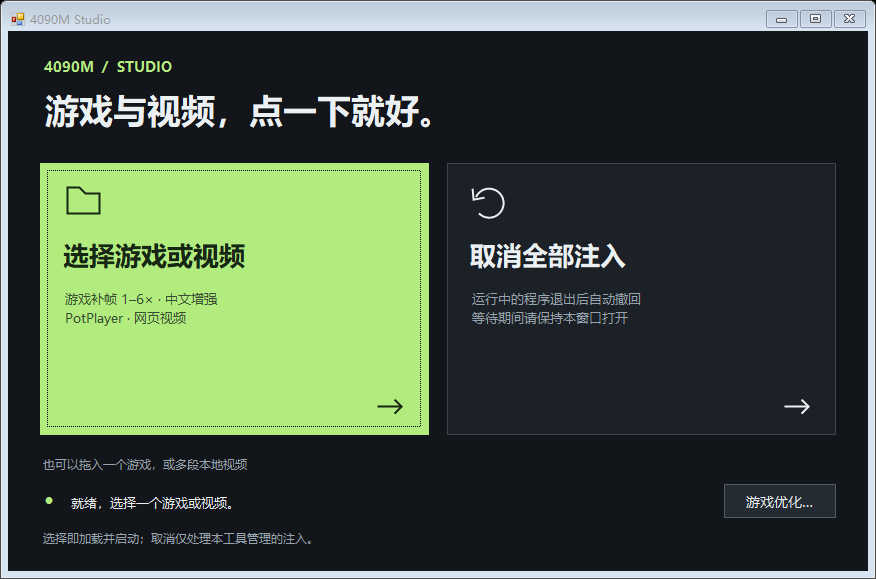
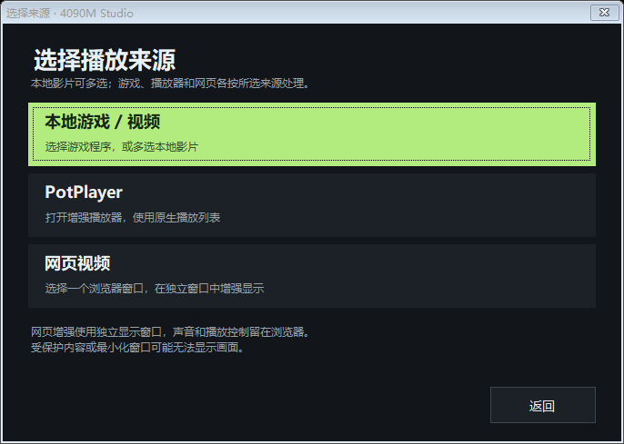

# 4090M Studio

适用于 Windows 的中文游戏优化与游戏、视频 NR 增强工具。双击 `4090M-Studio.exe`，可从主页选择游戏或视频、取消全部注入，或打开「游戏优化…」。

支持最小化到系统托盘。单击托盘图标或右键选择“打开主窗口”可恢复窗口；右键“退出软件”退出。隐藏后后台等待撤回仍会继续。

右上角关闭按钮也隐藏到托盘；使用托盘“退出软件”或 Alt+F4 真正退出。安装或撤回写入期间会等待完成后再允许退出。程序支持 `--tray` 启动参数，可将带此参数的快捷方式放入当前用户的 Windows 启动文件夹，使登录后自动启动并收起到托盘。



## 功能

- 游戏：选择兼容的 64 位游戏程序，校验并安装受管组件，然后请求启动。识别燕云十六声的双渲染目录和官方启动器布局。
- 游戏补帧：选择单个游戏后显示中文 1×–6× 设置窗。1× 撤回本工具的额外补帧，游戏自身 FG 开关保持独立；2×–6× 请求实验性的 RTX 40 多帧生成，进入游戏后仍需开启其原生 DLSS 帧生成。
- 游戏优化可显示整机 CPU、物理内存和 GPU 占用，并按手动名单或游戏配置降低选中后台程序的 CPU 调度优先级。可搜索程序、点击列标题排序、批量勾选当前筛选结果，或右键打开程序所在文件夹。
- PotPlayer：为已安装的 64 位 PotPlayer 加载增强，保留播放器偏好；支持多文件播放列表，播放期间可追加影片。
- 网页视频：选择浏览器窗口，通过 Windows 窗口捕获在独立窗口显示 NR 画面。声音和播放控制仍在浏览器，捕获上限为 30 帧/秒；受保护内容可能无法捕获。
- 中文：ReShade 与 NR Nexus 的常用菜单使用简体中文，原始调试信息可能保留英文。
- 撤回：仅按安装记录处理本工具管理的文件。运行中的游戏和原装 PotPlayer 等待正常退出后撤回；请保持工具打开。



本项目管理第三方 NR Nexus、OptiScaler Aurora 与社区兼容运行时，不是 NVIDIA 官方 DLSS 5 产品。加载成功不代表实际 NR 或所选补帧倍率已生效，画质、帧时间和操作延迟需以实际游戏为准。遇到已有其他注入文件或检测到反作弊组件时会停止覆盖，不修改官方游戏主程序或 Streamline。

补帧当前采用固定 [Aurora v1.1.2](https://github.com/abc354402600/OptiScaler-Aurora/releases/tag/aurora-v1.1.2) 的游戏原生 DLSS-G override。自动接入范围为静态导入 WINMM 的 x64 DX12 游戏，具有匹配的 Streamline 2.7.1+ 2.x 原生 FG 插件和 DLSSG 310.9。通过独立 `winmm.dll` 保留 ReShade `dxgi.dll`、已有 NR 参数和游戏官方 DLL。RTX 40 的多帧兼容补丁属于实验社区实现，不能保证所有场景的均匀帧时间或倍率；不支持时停止并提示，不静默降成其他倍率。视频和网页本轮保持原有 NR 增强，不加游戏补帧。

## 使用

环境：Windows 11 x64；游戏/视频 NR 需要兼容的 NVIDIA GPU 和驱动。本机受控测试使用 RTX 4090 Laptop GPU。播放器需要 Direct3D 11 渲染，游戏需要兼容的 DX11/DX12 路径。

1. 下载本仓库 ZIP 并解压到可写目录，保留目录结构。
2. 使用 PotPlayer 前先安装 64 位 PotPlayer；首次启用时关闭原先打开的普通播放器。NR 需要其“内置 Direct3D 11 视频渲染器”。
3. 网页增强和随附播放器模式需要先准备固定版本 mpv：在仓库目录运行 `powershell -File .\tools\Setup-Mpv.ps1`。脚本下载并校验原始包，只解压文件，不运行安装器。
4. 双击 `4090M-Studio.exe`。使用画面增强时选择来源，首次使用会下载并校验固定版本 NR 组件，相关文件保存在本地 `tools` 目录。

视频可以多选；已打开受管 PotPlayer 时再次选择视频会追加到原生播放列表。未安装 PotPlayer 时使用准备好的 mpv，多文件按顺序排队，`<`、`>` 切换。网页模式请保持源浏览器窗口未最小化，可先将视频全屏再选择窗口。

`Home` 打开插件菜单，`F6` 对比 NR 开关，`F11` 查看开销。语言迁移会保留原画质参数，运行中的程序需要正常重启后刷新语言。撤回只影响受管加载文件，修改过的配置及第三方文件会保留。

游戏补帧同时提供上游中文菜单；`Insert` 可查看 Aurora 设置。选择 2×–6× 时首次会准备固定补帧包和 GPL 许可，日志保存为游戏目录下 `4090M-FG.log`。日志记录补丁加载不代表已验证生成了不同新画面，需结合实际呈现和帧时间检查。若原装载文件已被外部修改，1× 会提示无法确认关闭并停止启动，避免误报；可用“取消全部注入”按所有权记录撤回。已修改文件仍会保留。

## 游戏优化

1. 在主页点「游戏优化…」，也可在 Studio 托盘菜单选「游戏优化」。首次打开即开始监控，之后启动 Studio 时会自动启用该功能。最小化或关闭优化窗口后，监控和优化会继续在 Studio 后台运行。
2. 手动模式使用后台应用列表中记住的勾选项。要按游戏切换规则，在「游戏配置」添加实际运行的游戏 `.exe`，开启「自动识别已配置的游戏」，再在主列表编辑该游戏的优化名单。保护名单可加入语音聊天、录屏等程序。自动模式等待已配置的游戏启动，游戏退出后会恢复相应后台进程的优先级。
3. 点击「暂停并恢复」可暂停优化并保留监控。Studio 的托盘菜单也会显示优化状态，并提供暂停或继续操作。通过托盘菜单「退出软件」或在 Studio 主窗口按 Alt+F4 时，程序会先恢复本次调整的进程优先级。异常退出后，下次启动会尝试恢复。

独立版游戏优化助手的设置和游戏配置继续从 `%LOCALAPPDATA%\GameBoost` 读取。若独立版正在运行，请先用其托盘菜单「退出并恢复优先级」，再从 Studio 打开游戏优化。

游戏优化使用 Windows 的 CPU 优先级调度，后台进程继续运行。GPU 和内存数据用于查看占用，实际帧率或帧时间变化取决于游戏和资源瓶颈。

仓库中的程序由当前源码构建。第三方大型组件、缓存、游戏文件、原装播放器和个人安装记录均不随仓库发布。所下载组件受各自许可证约束，详见 [THIRD_PARTY.md](THIRD_PARTY.md)。

## 构建与验证

使用 Windows 自带的 .NET Framework 4.x C# 编译器，无需安装 NuGet 包。

```powershell
powershell -File .\build.ps1
powershell -File .\test.ps1
```

默认运行离线检查，覆盖文件所有权、补帧配置、安装与撤回、语言迁移、日志证据、界面布局和游戏优化。游戏优化验证使用临时目录和受控测试进程。该套检查不涉及真实游戏注入、个人视频播放或真实驱动配置修改。

准备 mpv 且有 NVIDIA 驱动后，可显式增加只读硬件及播放器参数探测：

```powershell
powershell -File .\test.ps1 -WithHardware
```

该模式增加只读驱动和播放器检查。受控运行时证据和验证范围见 [docs/VALIDATION.md](docs/VALIDATION.md)。

源码使用 MIT 许可证；第三方组件不受本项目 MIT 许可证重新授权。

